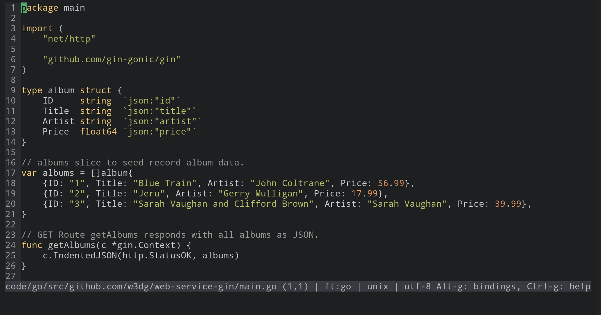
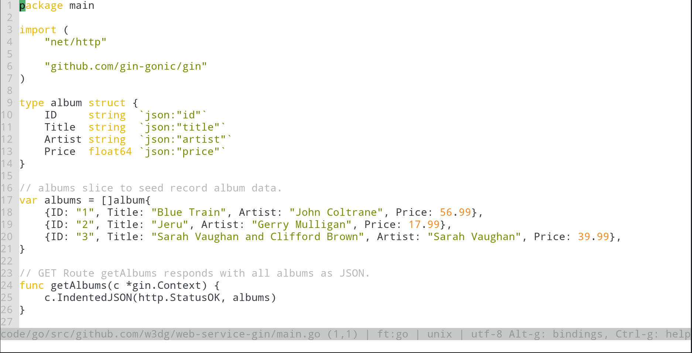
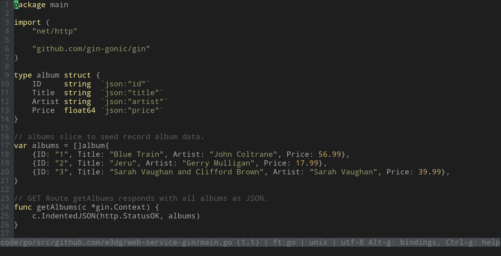

# base16-micro

[Base16](https://github.com/chriskempson/base16) Color Template for [micro](https://github.com/zyedidia/micro/). This template can be used with any compliant Base16 builder such as one from [Tinted Theming](https://github.com/tinted-theming/home#official-builders).

The themes are built into `themes/micro/colorschemes/`.

## tinty theme manager
To use the color theme manager [tinty](https://github.com/tinted-theming/tinty) add the `colorscheme` key value to your micro's `settings.json` if not already existent:
```json
{
    "colorscheme": "base16-bosque",
}
```


Then add this into your `$HOME/.config/tinted-theming/tinty/config.toml` ([sed](https://www.gnu.org/software/sed/) required):
```toml
[[items]]
path = "https://github.com/w3dg/base16-micro"
name = "base16-micro"
themes-dir = "themes/micro/colorschemes"
supported-systems = ["base16"]
hook = '''mkdir -p "$HOME/.config/micro/colorschemes" && cp -f "$TINTY_THEME_FILE_PATH" "$HOME/.config/micro/colorschemes/$TINTY_SCHEME_ID.micro" && sed -i "s/\"colorscheme\": *\"[^\"]*\"/\"colorscheme\": \"$TINTY_SCHEME_ID\"/" "$HOME/.config/micro/settings.json"'''
```


Afterwards sync tinty so your `config.toml` change gets acknowledged:
```
tinty sync
```


Now whenever you change your tinty theme, the new theme is automatically copied over to micro's `colorschemes` directory and applied via the micro `settings.json`.


## Screenshots

<details>
<summary>Screenshots</summary>
<br>
Tomorrow Dark Night

<br>
Tomorrow

<br>
Twilight

</details>

# Building themes

I am using `tinted-builder-rust` to build the themes from the template.

```sh
cargo install tinted-builder-rust
```

At the root of this repo, run

```sh
tinted-builder-rust build ./
```

The themes should be built into `themes/micro/colorschemes/`. 


Originally this is the work of [kytta/base16-micro](https://github.com/kytta/base16-micro/) under an ISC License.

I have updated the config of the template to match the [current guidelines](https://github.com/tinted-theming/home/blob/main/builder.md) according to Tinted Theming.
